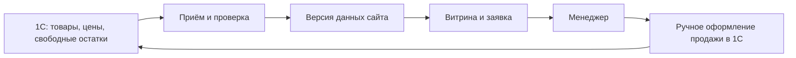

# Интеграция 1С — действующий план 9А–9Г

## Журнал1С прочитан — 16 октября 2026

VERIFIED read-only: владелец сохранил локальный exchange-log-2026-10-16.xml в .unlazy/1c-diagnostic;155480байт,SHA256 15dfe79ded37b17e3c932e60b34d40e27f7506dd98e658fb91d2170ea3ed164d. XML EventLog содержит157событий с22:10:45 по22:24:47,156Information и1Error. Единственная ошибка22:12:36 содержит отправку import0_1.xml и явный ответ диагностического приёмника «Diagnostic capture only; import disabled». Она объясняет отказ обработки первого каталога и совпадает с сохранённым capture; это преднамеренная диагностическая граница, не ошибка пароля и не причина, доказанная для следующего прохода.

В районе22:21 в этом XML есть сохранение узла22:21:00, но нет события выгрузки/ошибки, объясняющего авторизацию без файла22:21:01.539.157меньше видимого лимита200, но это само по себе не доказывает полноту всех событий и настройки регистрации. Причина второго прохода UNKNOWN. Возвращаться к ценам характеристик карандаша по догадке не нужно. Следующая контрольная проба должна быть на уже подтверждённом обычном лосьоне200мл с ограничением одной позиции. До запуска — подготовить и проверить журналирование отказов приёмника, намеренно перезапустить его с прежними реквизитами и сохранением файлов (старый запуск3из4сеансов); запуск1С остаётся ручным отдельным шагом. Витрина не изменена;9А IN_PROGRESS.

## Первая связь подтверждена владельцем — 16 октября 2026

USER_SPECIFIED: на сопоставление «La Sultane de Saba Парфюмерный лосьон-спрей Аюрведа 200 мл» из1С и «La Sultane de Saba Brume Ayurvédique» / «Флакон200мл» сайта владелец ответил: «Да, да это один и тот же товар». Подтверждение относится только к этому флакону, не к четырём отливантам той же карточки и не к основной базе.

VERIFIED основным исполнителем и независимым проверяющим: соответствующий offer встречается один раз, вариант сайта уникален и принадлежит выбранной карточке. Проверка без применения по сохранённому offers тестовой копии получает розничную цену5000RUB и количество0. Это исторические тестовые данные, а не текущие цена/наличие основной базы. На сайте прежняя цена4450 не изменена. Локальная запись .unlazy/1c-diagnostic/mapping-candidate-001.json теперь OWNER_CONFIRMED_TEST_COPY_ONLY, содержит точныеID, цитату подтверждения и результат проверки; applied=false. Доказана одна связь несмотря на разные названия, не массовая полнота сопоставлений или готовность обмена. Новый обмен не запускался. 9А IN_PROGRESS;9Б не объявлен завершённым.

## Отдельные товары 1С связать с вариантами сайта — уточнение 16 октября 2026

USER_SPECIFIED, голосовая сессия: владелец просит пропустить текущую проверку характеристик 1С. По его словам, характеристики используются только у одной позиции; остальные оттенки (например помад) заведены независимыми товарами. Названия на сайте и в 1С отличаются. Это сообщение владельца, а не доказанная инвентаризация всей базы. Основной сценарий: каждый вариант сайта связан с отдельной номенклатурой 1С; группировка карточек сайта сохраняется. Не создавать характеристики в 1С ради структуры сайта.

Пробы цен/остатков характеристик «Карандашь» отложены по поручению; они не объявлены пройденными. Четыре записи каталога подтверждены, но offers/цены/остатки не получены. Последний ручной проход зафиксировал только успешную авторизацию: в capture-jrnAc4 три сеанса, один прежний файл каталога; у последнего сеанса нет записанных init/file/import. Полного журнала отклонённых запросов нет, поэтому причина отсутствия файла UNKNOWN. Сообщение «Обмен завершён» не доказывает получение данных. Ранее записанные следующие шаги по карандашу ниже — история, заменённая этим поручением.

VERIFIED read-only: в data/products.json 4 526 карточек и 6 089 вариантов, каждый вариант имеет id; полей barcode или UUID 1С нет. scripts/import-catalog.py заполняет sku/sourceSkus из исторического MIG_ID; 257 вариантов без sku, 190 значений sku повторяются. MIG_ID не объявлять артикулом или GUID действующей 1С. Имена, цена и количество не являются ключом импорта.

Принцип связи 9Б: (источник базы, точный внешний ID товара/предложения) → существующий variant.id сайта, с привязкой к его product.id и зафиксированным доказательством соответствия. Для обычных позиций не требовать общий родительский UUID или характеристики 1С; независимые UUID могут вести к разным вариантам одной карточки сайта. Первичное сопоставление проверить через доступные исходные таблицы и реальные общие коды/штрихкоды, если они присутствуют с обеих сторон; названия, бренд, оттенок и объём служат подсказками для проверки, а не автоматическим подтверждением. Неоднозначные/неизвестные пары изолировать, при отсутствии надёжного ключа подтвердить вручную. Не распространять один остаток на все оттенки и не суммировать их по общей карточке. Подтверждённую связь сохранять, последующие обновления цены/остатка выполнять по ней; названия, фото, ID и группировку сайта не заменять. Смена тестовой базы на основную требует проверки области источника и связей, даже при совпадающих UUID.

Следующий шаг 9А: проверить доступные идентификаторы и происхождение исходных кодов read-only, выбрать пример двух отдельных товаров 1С, соответствующих двум вариантам одной карточки сайта, и зафиксировать доказательства/неизвестное. Реестр сопоставлений и пробное преобразование относятся к 9Б после приёмки 9А. Исключение с настоящими характеристиками сохраняется отдельным непроверенным случаем: до принятой обработки его данные не применять по догадке. Резервы, статус удаления, повтор/full/delta и остальные неизвестные 9А не закрыты. Новый обмен сейчас не запускать. Перед следующим согласованным проходом намеренно перезапустить локальный приёмник с прежними реквизитами и сохранением захватов (в текущем запуске использованы 3 из 4 сеансов). Витрина и учёт не изменены; 9А IN_PROGRESS.

## Четыре варианта получены в каталоге — 16 октября 2026

VERIFIED основным исполнителем и независимым проверяющим: после подтверждённых владельцем сохранения узла и одного ручного обмена в capture-jrnAc4 получен import0_1.xml,8440байт,SHA256 5441e5f4b2c0748c6135482c41330c02b4e6575cd1f2f63b2e3b1b6c2252cd24. CommerceML2.07, ДатаФормирования=2026-10-16T22:12:35 без явного часового пояса, СодержитТолькоИзменения=false только для выбранной области. В файле четыре элемента Товар: «Карандашь (30)», «(31)», «(32)», «(33)». У всех общий UUID до разделителя # и разные UUID после него; отдельной родительской записи без # нет. Это фактический способ представления вариантов в данном образце; отдельных XML-элементов характеристик нет. Стабильность ID при повторе/delta ещё не проверена.

Единица всех четырёх796/Штука/PCE, коэффициент1; реквизиты ВидНоменклатуры=Карандаши, ТипНоменклатуры=Товар, Полное наименование=Карандашь. Предложений, цен, количеств и складов в этом файле нет; наличие варианта33 по-прежнему UNKNOWN. Проверены уникальность четырёх ID, общий префикс, четыре наименования, единицы и отсутствие цен/остатков. События приёмника: init→zip=no, import→import_disabled; transportComplete=true, importAccepted=false. Сообщение1С «Обмен с сайтом завершен» не доказывает принятие импорта. Данные к витрине не применены.

Следующий шаг: в том же режиме и с прежним подтверждённым отбором одного карандаша выключить только «Каталог товаров», оставить цены/остатки включёнными и перечитать форму перед отдельным ручным проходом offers. Не переключать режим по догадке: ранее изменение режима меняло отображаемый отбор. Активен приёмник33812/capture-jrnAc4; использованы2из4авторизованных сеансов, новых файлов после этой пробы ещё не заявлено. Повтор автоматически не запускать;9А IN_PROGRESS.

## Характеристики и отбор пробы — 16 октября 2026

VERIFIED runtime16.10: приёмник намеренно запущен через экспорт startDiagnosticServer с прежними реквизитами; connection.json побайтово сохранён, хеши всех30 прежних файлов захватов неизменны. Новый capture-jrnAc4, управляемый сеанс33812, listener127.0.0.1:5179; captureOnly=true/importEnabled=false,0авторизованных сеансов/частей перед ручным проходом. Без авторизации init вернул401, orders/sale403. USER_SPECIFIED: владелец подтвердил все предложенные флажки и режим «Все данные». Следующий шаг — один ручной запуск после «Записать» в диагностическом узле, без отдельной проверки соединения; затем прочитать фактически полученные файлы. Отказ import ожидаем и не означает применения данных.

VERIFIED read-only UI тестовой копии: у «Карандашь» вид номенклатуры «Карандаши», отдельно тип «Товар», режим характеристик «Общие для вида номенклатуры». Через «Перейти» прочитан общий список вида:30,31,32,33. Это не доказательство четырёх предложений в CommerceML. В складском XLSX отдельно наблюдались30/31/32 по11; родительский итог33 — сумма, не остаток характеристики33. Цена/остаток характеристики33 UNKNOWN, отсутствие строки не подменяется нулём. USER_SPECIFIED: отчёт по отдельному складу «Склад» пуст; отдельный файл этого отбора не проверялся.

В узле с прежним кодом владелец изменил имя на «Выгрузка товаров GRACE GPT»; форма имеет признак несохранённых изменений. После смены режима на выгрузку описания/цен/остатков настройки характеристик стали доступны. Ранее выключенные условия относились к предыдущему наблюдению; текущую область перечитали отдельно. В списке видов первоначально был только «Товар»; владелец добавил существующий вид «Карандаши». Последний UI подтверждает строку «Товар; Карандаши» и полный отбор: Номенклатура Равно «Карандашь» И Тип цены Равно «Розничная» И Склад для остатков Равно «Магазин». Это подготовка текущей формы, не доказательство сохранения/успешного обмена и не установленная причина прежнего пропуска.

Следующий шаг: владелец выставляет каталог+характеристики+цены/остатки, выключает изображения и ограничение доступными предложениями, выбирает «Все данные» в пределах одного отобранного товара. Эти флажки ещё требуют подтверждения владельца; accessibility не передаёт их состояния. Перед последующим согласованным ручным запуском намеренно подготовить приёмник с прежними реквизитами и сохранением захватов: последний известный запуск исчерпал лимит сеансов. Никаких учётных движений, автоматического обмена или применения к витрине этим шагом не выполнено. 9А IN_PROGRESS.

## Повторный отчёт проверен — 16 октября 2026

VERIFIED: владелец сохранил новый файл под сегодняшним числом: локальный .unlazy/1c-diagnostic/stock-report-2026-10-16.xlsx. Основной исполнитель и независимый проверяющий сравнили его с stock-report-2026-10-15.xlsx через openpyxl read-only: оба по76 944байта, TDSheet 1441×5, все значения ячеек совпадают. SHA256 нового файла 7ee4dbfcf88489225bd06c96acae8b4d66e1a6a9918d9771b09a4c51b96697da; SHA различаются, побайтовое равенство не утверждается. Заголовки A4=«Магазин», D4=«Торговый зал», E4=«Итого»; отдельной колонки «Склад» нет. Строки376 и1281 по-прежнему содержат -1 против0 в ранее полученном XML. Период15.10.2026 прочитан в UI перед сохранением; дата имени файла не является периодом отчёта, сам XLSX периода/условий отбора не содержит.

Совпадение отчётов не доказывает, что второй склад пуст или что XML суммирует оба склада. Причина двух расхождений и отсутствие характеристик «Карандашь» остаются открытыми. Следующий шаг: владелец открывает штатный диагностический узел «Выгрузка товаров», одноимённую вкладку; прочитать действующие отборы и настройки характеристик до выбора следующего ограниченного прохода. Новый обмен/сохранение/учётные движения не запускаются, данные к витрине не применяются. 9А IN_PROGRESS. Предыдущие точки остановки ниже — история, уточнённая этой записью.

## Связь магазина и складов проверена — 16 октября 2026

VERIFIED read-only UI: обе карточки «Торговый зал» (тип «Торговый зал») и «Склад» (тип «Складское помещение») содержат поле Магазин=«Магазин». Это доказывает принадлежность двух складов одному магазину в тестовой копии, но не агрегацию остатков в XML и не совпадение внешних ID. Владелец получил инструкцию сформировать отчёт за15.10.2026 с отбором Магазин=«Магазин», без отборов склада/товара/характеристики. Дождаться результата; сравнить с предыдущей выгрузкой, не придумывая причину расхождений. Ни записи карточек, ни новый обмен агентом не выполнялись.

## Уточнение источника и порядка проверки — 16 октября 2026

USER_SPECIFIED: открытая 1С — **копия основной базы**. Все полученные import/offers и складской XLSX относятся к этой копии. Владелец сообщил о минусах в копии и неизвестной причине; основная база ещё не исследована. Измеренные количества сохраняются как факты копии, без переноса выводов на основной учёт.

Принятый порядок: **сначала интеграционные тесты на копии, затем переход к основной базе**. Этапы 9А→9Б→9В→9Г сохраняются. Причину минусов и исправление учёта копии не расследовать как обязательное условие интеграции; проверить правильность передачи и обработки отрицательного количества без молчаливой подмены нулём. Два расхождения отчёт/XML, область «Магазин»/«Торговый зал», характеристики и резерв остаются техническими вопросами.

- На копии: идентификаторы и характеристики, цены/единицы, положительное/нулевое/отрицательное/неизвестное/устаревшее наличие, резерв ровно один раз, полный обмен и изменения, повтор/обрыв/перезапуск, область покрытия и расписание. Контрольные состояния воспроизводить в тестовом окружении; перед любыми учётными движениями достоверно отличить копию от основной базы. Само уточнение не запускает движений, автоматического ввода или обмена.
- Граница сайта сохраняется: данные 1С→сайт, заявка→менеджер; сайт не создаёт в1С заказы, резервы и списания. Тесты не отправляют реальные уведомления и не публикуют сайт.
- Переход после успешной проверки: отдельно проверить основную базу, профиль отправителя, источники ID/цен/склада и место хранения. Копия может сохранить UUID оригинала; один совпавший UUID не доказывает правильный источник. Тестовый снимок и его давность не использовать как рабочие данные.
- Первый рабочий снимок получать полным обменом из основной базы в изолированное промежуточное состояние, сверять выборку товаров/характеристик/цен/остатков, затем активировать в разрешённой среде. Проверка копии не доказывает сетевую доступность, расписание или актуальность основной базы; их проверять при переходе. Публикация и приём реальных заявок остаются отдельным поручением.

Независимая проверка плана уточнила границы перехода: перед тестами прочитать унаследованные узлы и расписания копии, чтобы установить фактические назначения, ничего не перенаправляя автоматически. Сеансы, версии и история повторов разделяются по источнику; запоздалый пакет копии не активируется как рабочий, delta основной базы не накладывается на тестовый снимок. До подтверждённой полной версии основной базы сохраняется прежний режим сайта; откат не возвращает тестовые остатки. Реальное исполнение двух обновлений через12часов проверяется отдельно от синтетической проверки24часов; после перехода проверяется исполнитель основной базы. Это требования к будущим тестам/переходу, а не выполненные проверки настроек.

Ближайший шаг9А: подтвердить, как отличать текущую копию от основной базы без раскрытия реквизитов, затем продолжить проверку области склада и характеристик на копии. Заданный ранее вопрос о списке «Склад» сохраняет смысл для проверки области, но минусы копии не являются диагнозом основного учёта. 9А IN_PROGRESS; никаких тестов или переключения этой записью не объявляется завершённым.

## Сверка со складским отчётом — 16 октября 2026

VERIFIED основным исполнителем: владелец сохранил локальный XLSX (76 944 байта, SHA256 aae6c26a4d27252f9a4b722fa7bb7c6daae7f1f39f946e02d7c225016a1066f9). В TDSheet указаны «Магазин», колонка «Торговый зал» и «Количество». Минусы присутствуют в самом отчёте. Период 15.10.2026 прочитан в UI; XLSX не содержит даты и условий отбора. Совпадение области с XML-складом «Магазин» ещё не доказано.

Среди 1 392 строк без характеристики сравнение по уникальным названиям с удалением только крайних пробелов дало 1 369 равных количеств (1 368 отрицательных и одно положительное), два различия, 15 несовпавших названий и шесть неоднозначных строк. У Levrana «Масло для бровей и ресниц, 7 мл» (строка 376) и «Мочалка полотенце корея» (1281) в отчёте -1, в XML 0. Это диагностическое сравнение: в отчёте нет UUID, названия не являются ключом будущего импорта, одинаковый момент и область данных не подтверждены. Причина минусов и расхождений не установлена.

В строках 974–976 отчёта есть «Карандашь» с характеристиками 30/31/32 по 11 шт.; строка 973 содержит их сумму 33 и повторно не учитывается. Предложения с таким названием в полученном XML нет. Это существующий пример для проверки характеристик; создавать тестовые движения не требуется.

**Точка остановки:** владелец получил просьбу открыть список выбора поля «Склад» в отчёте, ничего не выбирая. Подтверждения открытия пока нет. Далее проверить область склада, две различающиеся строки и передачу характеристик; резервы и full/delta остаются открытыми. Новый обмен автоматически не запускать, данные к витрине не применять. 9А IN_PROGRESS, 9Б–9Г не начаты. Разделы о подготовке, паузе и первом соединении ниже сохраняются как история; эта запись уточняет текущий следующий шаг.

## Фактические образцы получены — 15 октября 2026, поздний ручной проход

**9А IN_PROGRESS; 9Б–9Г не начаты; 14/30.** Владелец разрешил пробную выгрузку и вручную сохранил отдельный штатный узел «Выгрузка товаров», код 000000001, на локальный приёмник 5179. Получены каталожный `import0_1.xml` с одним выбранным товаром и отдельный `offers0_1.xml` с 4 371 предложением. Во втором проходе владелец сообщил, что отбор не указал. Это не доказательство полноты базы и не единый атомарный снимок. Витрина не изменена, импорт намеренно отклонён. [Фактический протокол и исправление диагностики](1C-DIAGNOSTIC.md).

VERIFIED: в offers обнаружены 1 388 отрицательных, 2 982 нулевых и одно положительное количество. Значения не исправлялись и не переносились на сайт. USER_SPECIFIED, уточнение 15.10: владелец сверил выбранный лосьон — **5 000 RUB и 0 шт.** — с 1С и ответил «Да, совпадает». По его сообщению, резервов сейчас нет; вычет ненулевого резерва остаётся непроверенным.

Следующий шаг — прочитать складской отчёт через раздел «Склад» и проверить отрицательные количества. Повторная выгрузка сейчас не требуется. Ранние ограничения «только соединение» и пауза ниже — история, отменённая последующими поручениями; автоматические учётные действия по-прежнему запрещены.

## Возобновление 15 октября 2026

USER_SPECIFIED: «продолжаем 1с». Пауза снята; **9А IN_PROGRESS**, 9Б–9Г не начаты, 14/30. Подготовка локального диагностического захвата ведётся отдельно: [TASK-20261015-001](context/tasks/TASK-20261015-001.md). Фактический обмен ещё не проверен; сохранение/запуск штатного узла — отдельное конкретное действие после подготовки. Запись о паузе ниже сохранена как история.

USER_SPECIFIED / VERIFIED 15.10: владелец разрешил **только проверку соединения без сохранения и выгрузки**. Он сообщил «Соединение успешно»; локальный приёмник зарегистрировал один авторизованный сеанс, 0частей файлов, без init/import. Проверка связи завершена; сохранение узла и выгрузка ещё не разрешены. 9А остаётся открытым до фактического образца.

## Пауза по просьбе владельца — 15 октября 2026

**9А PAUSED, не завершён; 9Б–9Г не начаты; 14/30.** [Точная точка продолжения](1C-PAUSE-2026-10-15.md). Владелец сообщил: штатный список пуст; открыта новая форма-шаблон, а не готовый обмен. Доступные элементы формы прочитаны; положения галочек не являются принятыми решениями. Проект настройки показан, но не применён. После просьбы продолжить — подготовка диагностического приёмника и проекта нового штатного узла; затем проверка реальных данных без изменения витрины. Ничего не запускать/не сохранять в 1С автоматически; старый профиль «Grace» не перенаправлять.

15 октября 2026, Europe/Moscow. [TASK-20261014-003](context/tasks/TASK-20261014-003.md). **9А IN_PROGRESS после просьбы продолжить; 9Б–9Г не начаты; итог проекта 14/30.** Аудит плана не является готовой интеграцией. Исходные [подзадания](STEP-09-SUBTASKS-ASTRA.md) и [требования](REQUIREMENTS-FINAL-REVIEW.md) сохраняются; их уточнения приведены здесь. Полная предыдущая редакция с исследованиями, осмотром 1С и историей решений сохранена в [архиве](1C-INTEGRATION-HISTORY-2026-10-15.md).

Метки: USER_SPECIFIED — решение владельца; VERIFIED — проверенный код/материал/содержание источника; PROPOSED — проект реализации; UNKNOWN — ещё нет достаточного свидетельства. Технический план ниже не означает выполненную настройку.

## 1. Цель и граница учёта

**USER_SPECIFIED 15.10:** данные идут из 1С в сайт. Заявка сайта передаётся менеджеру; менеджер вручную оформляет продажу и списывает товар в 1С. Сайт не выгружает в 1С заказы, покупателей, оплаты или документы, не создаёт резервов и не списывает складские остатки, в том числе в собственной копии остатков.

Стрелка от менеджера означает действие человека, а не автоматический канал сайта в 1С. Ответы сайта на авторизацию, загрузку и обработку файлов — техническое подтверждение протокола. Они нужны при одностороннем движении бизнес-данных.

Проверка количества в заявке читает последний снимок и ничего не резервирует. После продажи менеджером новый остаток попадёт на сайт при следующем успешном обмене. **Следствие выбранной схемы:** несколько клиентов могут запросить одну последнюю единицу до обновления; подтверждение менеджера остаётся необходимым. Удаление отправленных позиций из корзины браузера не является списанием товара со склада.

## 2. Принятые правила

| Правило | Статус и источник |
|---|---|
| Прежняя 1С:Розница (базовая) **2.3.8.22** на ноутбуке; расширение **«Интернет-магазин + „1С“» 8.0.0.18**; перенос в чистую базу не входит в работу | USER_SPECIFIED 14–15.10; полный релиз/расширение сообщены из «О программе», дословный текст в TASK |
| Розничная цена, один склад, вычитать резервы ровно один раз | USER_SPECIFIED 14.10; если передано уже свободное количество, второй вычет запрещён |
| Обновлять каждые 12 часов; через 24 часа без успешного подтверждения наличие неподтверждённое | USER_SPECIFIED 14.10; расписание пока не подключено |
| При известной последней цене и неизвестном/устаревшем наличии разрешать заявку с пометкой «Цена и наличие требуют подтверждения» | USER_SPECIFIED 15.10: «Разрешать заявку с пометкой для менеджера». Пометка нужна клиенту и в снимке/уведомлении менеджеру; количество не выдаётся за подтверждённое |
| Подтверждённый актуальный ноль или отсутствие цены → «Добавить в лист ожидания»; нет цены → «— ₽»; известную цену сохранять видимой | Исходные требования, пункт 16; подтверждено формулировкой вопроса и ответом владельца 15.10. Старый ноль после потери актуальности относится к неизвестному наличию, а не к подтверждённому нулю |
| Контент, изображения, ID, варианты, адреса страниц, корзина и избранное сохраняются | Исходные задания 9А–9Г и AGENTS.md |

Последнюю проверенную цену хранить вместе с происхождением и временем. Источник последней известной цены должен быть обозначен: историческая цена JSON не является проверенной актуальной ценой 1С. Поведение устаревших данных теперь принято; старое предложение полностью блокировать такую заявку отменено. Ни правило 12/24 часа, ни вычет резервов не разрешают создавать резерв по заявке сайта.

## 3. Что перепроверено и что исправлено в плане

- **VERIFIED:** официальный протокол отделяет каталог от обмена заказами. Штатная подсистема обмена с сайтом присутствует в документации Розницы 2.3. Поэтому первым проверяем штатный «Обмен с сайтом», на который указал владелец. Необходимость дополнительного модуля Битрикс, CMS Битрикс, собственного JSON или смены редакции 1С не доказана. [Протокол 1С](https://v8.1c.ru/tekhnologii/obmen-dannymi-i-integratsiya/standarty-i-formaty/protokol-obmena-s-saytom/), [изменения Розницы 2.3.1](https://its.1c.ru/db/content/updinfoarch/src/retail23/2.3.1/index.htm).
- Ранее осмотренный профиль дополнительного модуля «Grace» и штатный узел — разные объекты исследования. «Розничная», выключенные галочки резервов/предложений относятся к прежнему профилю; приписывать их штатному узлу нельзя. По осмотру 14–15.10 зафиксирована «Розница (базовая), редакция 2.3»; в этом аудите UI повторно не открывался. Версия платформы 8.3.18.1363 не определяет полный релиз конфигурации 2.3.x.x.
- По поручению «файлов обмена не будет» поиск сохранённых выгрузок прекращён. Нужен фактический формат выбранного отправителя, но он может быть получен отдельным диагностическим HTTP-захватом. Это PROPOSED способ получения доказательства, не уже выполненный обмен и не разрешение менять рабочий профиль.
- Формулировка «передача заказов обратно — отдельная задача» заменена действующим запретом обратного обмена и автоматических складских движений. Отдельного модуля заказов в 1С в этом плане нет.
- Полный срез каждые 12 часов, D1/R2, точный адрес приёмника и способ восстановления — технические предложения до проверки условий. Они не выдаются за настроенные возможности.
- В приёмку возвращены исходные требования ожидания, сохранения корзины, всех потребителей каталога и определения поступления без рассылки. Статусы 9Б–9Г исправлены на «не начаты, после приёмки предыдущего», без прежнего переноса после фото.

### Дополнение 15.10 — точные версии получены

USER_SPECIFIED 15.10, сведения из «О программе»: **Розница (базовая) 2.3.8.22**; установленное расширение **«Интернет-магазин + „1С“» 8.0.0.18**. Полный релиз больше не UNKNOWN; повторно запрашивать его не нужно. Это разные номера конфигурации и расширения, не версия платформы и не доказательство фактического диалекта/работоспособности обмена.

VERIFIED по [официальной карточке расширения](https://1c.1c-bitrix.ru/ecommerce/download.php?id=17155050): модуль 8.0.0.18 опубликован для Розницы 2.3.9.42. Это отличается от сообщённого релиза 2.3.8.22; сама карточка не устанавливает ни совместимость, ни несовместимость установленной пары. Обновление/удаление расширения или рабочей базы на этом основании не назначается. Штатный обмен остаётся первым проверяемым вариантом; наличие дополнительного расширения не обязывает использовать его для нового сайта.

VERIFIED: [официальные изменения 1С](https://dl04.1c.ru/content/RetailBase/2_3_8_22/news.htm) подтверждают существование именно базовой Розницы 2.3.8.22. Возможности передачи нужных ключей/цен/свободных остатков и работы расписания в этой установке остаются UNKNOWN до проверки. Исторические ошибки с указанным исправлением в 2.3.4 не являются доказательством их наличия в более позднем 2.3.8.22.

## 4. Реальное состояние кода на 15.10

| Проверено чтением текущих файлов | Значение для интеграции |
|---|---|
| [catalog.ts](../lib/catalog.ts) читает JSON и создаёт карты товаров/вариантов при загрузке модуля | Динамического слоя 1С ещё нет; обновления одного API недостаточно |
| В JSON 4 526 товаров / 6 089 уникальных вариантов; 257 вариантов без SKU; 190 повторяющихся SKU у 760 вариантов; availability везде unknown | SKU и название не являются достаточным ключом связи. Эти значения не подтверждают реальные остатки |
| [demo-inventory.ts](../lib/demo-inventory.ts) задаёт тестовый лимит 1; [order-runtime.ts](../lib/order-runtime.ts) использует статический каталог и этот лимит | Демо-количество нельзя принять за склад 1С |
| [order-service.ts](../lib/order-service.ts) читает варианты и сохраняет guest_orders; [миграция](../db/migrations/0001_guest_orders.sql) создаёт только Telegram outbox | В этой цепочке нет списания, резерва или отправки заказа в 1С. Сохранить эту границу |
| Сервис допускает async lookupVariant, сохраняет revision/source, возвращает cart_changed; available=null сейчас блокирует заявку | Точки подключения уже есть. Разрешение заявки при неизвестном наличии из нового решения ещё НЕ реализовано; нужна явная неподтверждённость без фиктивного количества |
| Варианты читаются отдельно по строкам; revision только сохраняется, 24-часовой проверки нет | На расчёт одной заявки нужно закрепить один снимок; версии не смешивать |
| Корзина хранит старые объекты/цены; consumeOrderedItems в [shop-state.ts](../lib/shop-state.ts) удаляет количества только из корзины | Обновлять сведения по ID, сохраняя выбор до подтверждения; это не складское движение |
| В app/api нет маршрута 1С; в [схеме](../db/schema.ts) нет таблиц импорта/остатков; в [.openai/hosting.json](../.openai/hosting.json) d1/r2=null | Промышленный приёмник/хранилище 1С не реализованы; отдельный локальный диагностический приёмник существует. Это локальная конфигурация, не проверка remote bindings |

## 5. Проверенный фрагмент контракта и недостающие доказательства 9А

VERIFIED по двум локальным XML и очищенной трассе реальной 1С; исходные файлы исключены из Git. Статистику offers независимо проверили основной исполнитель и агент. Примеры ключей ниже обозначены по роли; реальные UUID не заменяют существующие ID сайта.

| Поле / операция | Фактически наблюдалось | Предел вывода |
|---|---|---|
| Диалог | Два `checkauth`, затем `init/file/import`; на последующих шагах cookie и дополнительный `sessid`. Условие `zip=no` соблюдено | Полный успешный импорт не выполнялся: `import` всегда возвращал `failure`. Сеансы и значения `sessid` не публикуются |
| Формат | `КоммерческаяИнформация`, `ВерсияСхемы=2.07`, `ДатаФормирования` без явного часового пояса | XSD-валидация и дрейф часов пока не проверены |
| Каталог | `import0_1.xml`, 3 429 байт, один `Товар`; `Товар/Ид` — UUID, отдельный `Штрихкод`, пустой `Артикул` у выбранного товара | Только выбранный товар; связь с `variant.id` сайта относится к 9Б |
| Предложения | `offers0_1.xml`, 4 912 282 байта в трёх последовательных POST-частях; 4 371 уникальный `Предложение/Ид`, дублей и ID с разделителем `#` нет | Второй запуск выполнен без отбора по сообщению владельца. Полнота базы и всех вариантов не доказана |
| Связь | `ПакетПредложений/ИдКаталога` совпадает с `Каталог/Ид`; у выбранного товара `Предложение/Ид` совпадает с `Товар/Ид` | Правило характеристик и отливантов ещё не установлено |
| Цена | Вид цены: UUID, «Розничная», RUB. В `Цена` переданы `ИдТипаЦены`, `ЦенаЗаЕдиницу`, `Валюта`, `Коэффициент`; все 4 371 цены положительные. Владелец подтвердил цену выбранного лосьона 5 000 RUB | Отсутствующая, удалённая и нулевая цена не представлены. Маркер удаления предложения не равен удалению цены. Налог: НДС, `УчтеноВСумме=false`, `Акциз=false`; не добавлять налог к розничной цене по догадке |
| Единица | Во всех предложениях `БазоваяЕдиница`: код 796, «Штука», PCE; коэффициент 1 | Миллилитры, отливанты и пересчёт ещё не доказаны |
| Количество | `Предложение/Количество`: 2 982 нуля, 1 388 отрицательных значений и одно положительное. Владелец подтвердил 0 шт. у выбранного лосьона | Причина отрицательных значений и семантика свободного остатка не установлены. Отрицательное значение не превращать молча в подтверждённый ноль |
| Склад | Классификатор содержит склад «Магазин». У 1 391 предложения есть `Склад` с атрибутами `ИдСклада`, `КоличествоНаСкладе`; во всех этих случаях сумма складских количеств равна `Количество`. Остальные 2 980 предложений не имеют элемента `Склад`, но содержат явное `Количество=0` | Отсутствие элемента склада здесь не означает отсутствующее количество. Нужна сверка со штатным складским отчётом |
| Резервы | USER_SPECIFIED: резервов сейчас нет | Вычет ненулевого резерва не проверен; не вычитать его второй раз по предположению |
| Статус предложения | У 809 предложений `Статус="Удален"`: 102 нулевых и 707 отрицательных количества. У 3 562 атрибут отсутствует: 2 880 нулевых, 681 отрицательное и одно положительное количество | Маркер удаления предложения наблюдался, но его связь с физическим удалением или пометкой удаления и поведение в delta не проверены. Отсутствие атрибута не доказывает активность |
| Полный / частичный обмен | В `Каталог` и `ПакетПредложений` указано `СодержитТолькоИзменения=false` | Полнота согласованной области, поведение delta и граница завершения ещё не проверены; две выгрузки сделаны раздельно |

| Ещё UNKNOWN | Что получить и сверить |
|---|---|
| Реализация отправителя | Отправка из выбранной формы и отдельного узла фактически состоялась. Принадлежность реализации расширению и исполнитель расписания не установлены; версии повторно не запрашивать |
| Идентификаторы и варианты | Фактические ключи номенклатуры/характеристик, связь с существующими вариантами сайта, MIG_ID/штрихкодом. MIG_ID исторической книги не объявлять текущим GUID |
| Цены | UUID розничного вида цены, RUB, 796/PCE и коэффициент 1 получены. Остались смысл налоговых полей, отсутствие/удаление цены и цены характеристик |
| Остатки | UUID склада «Магазин» и количественные поля получены. Остались связь с областью отчёта «Торговый зал», расхождения, свободное количество/резерв и отсутствующие значения |
| Отливанты | Отдельные позиции/характеристики или общий запас миллилитров; проверенное правило цены и расхода единицы каждого объёма. Без этих данных формулу не придумывать |
| Состав обмена | CommerceML 2.07 и import/offers получены. Остались полнота области, delta, зависимости и граница завершения, порядок/повторы. Нельзя выводить полноту по имени или числу строк |
| Среда | Защищённый HTTP-адрес и постоянное хранилище основного проекта; доступность HTTPS с этой платформы; исполнитель расписания на ноутбуке |

Для проверки структуры достаточно малого представительного образца: обычный товар, два его варианта, отливант при наличии, существующий ноль/резерв/отсутствие цены. Не создавать эти состояния в рабочей базе ради теста. Исторические XLSX полезны для сопоставления, но не содержат доказанного полного контракта и актуальных остатков. Рабочие выгрузки, себестоимость, клиенты, заказы, пароли и cookie не публикуются; тестовые примеры обезличиваются с сохранением связей ключей.

**Граница 9А/9В:** 9А требует проверить фактическую структуру и записать ожидаемый контракт. Если файлов нет, отдельно подготовить способ диагностического получения данных без подключения к витрине; не требовать заранее готовый промышленный приёмник 9В. Любая необходимая для этого тестовая настройка/запуск согласуется отдельным конкретным действием после подготовки. Рабочий профиль «Grace» не перенаправлять. Полную совместимость диалога, сбои и долговечность доказывать на 9В. Если формат ещё неизвестен, 9А остаётся открытым.

## 6. Единый порядок выполнения и приёмка

| Этап | Что делаем | Проверяемый результат | Сейчас |
|---|---|---|---|
| **9А — контракт** | Проверяем штатного отправителя, фактическую структуру, принятые правила и доступный путь получения. Записываем неизвестное и ожидаемый диалог | Источник/формат/ключи/единицы/цена/резервы проверены по данным, ограничения явно перечислены; правила поведения известны; данные сайта и учёт не изменены | **IN_PROGRESS**: import/offers получены; сверка остатков/резервов, варианты/отливанты иdelta ещё открыты |
| **9Б — связь вариантов** | Реестр «источник базы + внешний ID отдельной номенклатуры → существующий variant.id и его product.id». Разные UUID могут быть вариантами одной карточки. Первичное подтверждение связи при разных названиях; случай реальных характеристик отдельно. Пробное преобразование без записи | Числа сопоставленных/исключённых строк и примеры цен/остатков; несколько товаров и два варианта одного; объём/оттенок/аромат/формат различены; совпадения SKU/неоднозначность изолированы; ID/контент сохранены | Не начат, после 9А |
| **9В — приём** | Аутентификация, совместимый каталоговый диалог, постоянное промежуточное хранение, валидация и диагностика. Витрина ещё не подключена | Проверки матрицы ниже; реальная контролируемая сессия отправителя; инструкции запуска/ошибок; ошибочный или неполный пакет не объявлен успешным. Синтетика отдельно от реального подключения | Не начат, после 9Б |
| **9Г — использование** | Общий источник цен/наличия для всех экранов и серверной заявки, 24ч, ожидание/неподтверждённость, переключение демолимита, откат | Точные варианты/цены/состояния, сохранная корзина, одна версия на заявку; заявки не меняют склад/1С; сбои/восстановление и реальные данные сверены; правила поступления без отправки уведомлений | Не начат, после 9В |

Каждый этап имеет отдельную задачу, критерии и независимую проверку с перепроверкой основным исполнителем. Следующий этап не начинается автоматически от завершения исследования предыдущего. Развёртывание и включение реальных заявок остаются отдельными поручениями; опубликованная копия для друзей исключена.

## 7. Технический план — PROPOSED, реализация впереди

**На стороне 1С:** первым использовать штатный обмен, если фактическая проверка подтвердит нужные данные. В будущем отдельном узле выбрать каталог/цены/остатки/нужные характеристики, розничный вид цены и единственный склад; отключить обмен заказами. Существующие фото/описания сайта автоматически не заменять. Сначала контролируемый ручной обмен и сверка, затем расписание. Отдельный штатный узел и переключатели каталога/цен/остатков проверены в ручной диагностике. Возможность вычета резервов и работа расписания ещё UNKNOWN. Если штатных полей недостаточно, сначала описать доказанный недостаток, затем выбирать поддерживаемую доработку; не назначать модуль или обновление наугад.

**На стороне backend:** собственный маршрут текущего приложения (например /api/1c/exchange), только каталог. Операции type=sale отклонять понятной ошибкой без данных заказов; не реализовывать пустой «успешный» обратный обмен. Alias со словом bitrix нужен лишь при доказанном ограничении отправителя; PHP/CMS для такого URL не требуются сами по себе. Постоянно хранить принятые части, сеансы, связи и версии данных; D1/R2 — кандидат по текущему runtime, не выделенные ресурсы. Проверить bindings/лимиты по измеренному объёму. Данные обмена не хранить только в памяти процесса или файлах сборки.

Различать «часть сохранена», «файл обработан», «обмен завершён», «версия активирована». Базовый протокол задаёт checkauth/init/file/import; success при file подтверждает сохранение, при import — обработку указанного файла. Обязательная общая команда complete в базовом описании не установлена. Без доказанной границы всего согласованного обновления автоматическую активацию не включать. [Официальный протокол](https://v8.1c.ru/tekhnologii/obmen-dannymi-i-integratsiya/standarty-i-formaty/protokol-obmena-s-saytom/).

Файлы проверять отдельно, строить полное состояние-кандидат (delta накладывается на подходящую предыдущую версию), затем атомарно выбирать активную версию. Общие классификаторы не удалять после первого файла или повторного init. Сохранять предыдущую версию для восстановления. Полный срез каждые 12 часов — возможный первый режим, только если размер/время позволяют; корректность full и delta проверить в любом случае.

**Правила обработки:**

- Подлинность каждого шага, отдельные серверные секреты и изоляция сеансов; HTTPS без отключения проверки сертификата. XML без DTD/внешних сущностей, безопасные пути/имена, лимиты файлов/размеров/времени; ZIP только с проверкой распаковки. Для начала можно предложить zip=no, если отправитель его соблюдает.
- Ноль, отсутствие поля/строки, явное удаление и непокрытая область — разные состояния. Пропуск в delta не обнуляет количество и не стирает цену. Полный пакет не разрешает удалять карточки/обнулять отсутствующее до проверки области и семантики источника. Неизвестные соответствия изолируются.
- Повтор обработки не меняет результат повторно; старые/пересекающиеся сессии не перезаписывают новый снимок. Порядок не основывается только на часах ноутбука. Если у части нет номера/смещения, одинаковые байты не доказывают дубль: неоднозначную передачу не активировать, повторить в новой сессии.
- Хранить раздельно время источника, приёма/активации, область покрытия, ревизию и версию сопоставления. Авторизация/повтор файла/ошибка не освежают наличие. Обмен «изменений нет» подтверждает свежесть только при доказанной проверке всей нужной области. Непокрытые варианты не становятся свежими автоматически.
- При ошибке остаётся прошлое значение с исходным возрастом. Откат не сбрасывает маркеры обработанных обменов и не делает старые данные свежими. После отката delta нельзя применять к неподходящей базе; до доказательства непрерывности требуется новый полный срез.
- Деньги нормализовать в копейки с проверкой валюты, единиц и коэффициентов. Нулевую/некорректную цену не превращать в бесплатный товар; скидки не выдумывать. Количество хранить с единицей источника; продаваемые штуки и дроби переводить только по подтверждённому правилу.
- При общем запасе отливантов проверять суммарный объём всех строк одной заявки; не выдавать каждому объёму независимый полный запас. Это чтение и проверка, без уменьшения запаса или резерва. Несколько заявок не образуют скрытую очередь складского резервирования.

## 8. Охват сайта на 9Г

| Потребитель | Что проверить при подключении |
|---|---|
| Каталог/категории/бренды/поиск — [catalog.ts](../lib/catalog.ts); главная — [page.tsx](../app/page.tsx) | SSR и фильтры/сортировка получают актуальные данные одной модели; карты при загрузке модуля не удерживают старые цены |
| Страница товара, рекомендации, статьи; [collections.ts](../lib/collections.ts) | Не остаются статические копии цен в подборках и связанных товарах |
| Общая [карточка варианта](../components/variant-product-card.tsx) и [страница товара](../components/product-detail.tsx) | Обновлены отдельные stock, демолимит и подписи; замены одного availability недостаточно |
| Избранное/история — [saved-products.tsx](../components/saved-products.tsx), [API](../app/api/catalog/route.ts) | Согласованное время/версия, учтён кеш ответа |
| Корзина/checkout — [shop-state](../lib/shop-state.ts), [store-shell](../components/store-shell.tsx), [personal-pages](../components/personal-pages.tsx), [guest-checkout](../components/guest-checkout.tsx) | Обновление сведений по сохранённым ID, без молчаливого удаления/урезания выбора; изменения цены/подтверждённого количества требуют явного решения |
| Серверная заявка и сообщение менеджеру — [order-service](../lib/order-service.ts), [order-runtime](../lib/order-runtime.ts), [telegram](../lib/telegram-outbox.ts) | Одна ревизия на заявку, известная цена проверена на сервере; unknown/stale допустимы по решению владельца и явно помечены. Не подставлять фиктивное количество для обхода available=null. Снимок хранит происхождение/давность; уведомление сохраняет эту оговорку; склад/1С не изменяются |

Поступление готовить как событие точного варианта с защитой от повтора. PROPOSED минимальное правило — подтверждённый переход актуального количества 0 → >0 между последовательными корректными версиями. Первичная загрузка, восстановление unknown/stale, откат и изменение одной цены не являются поступлением. Точное правило закрепить и проверить на 9Г; отправка WhatsApp/других уведомлений о поступлении в этап 9 не входит.

## 9. Проверочная матрица и готовность

| Область | Обязательные сценарии |
|---|---|
| 9Б, идентичность | Несколько товаров, два варианта одного; повтор SKU/нет SKU; неизвестный/неоднозначный ключ; объёмы/оттенки/ароматы и отливанты |
| 9В, протокол | Успех/ошибка авторизации и cookie, повтор init/import, связанные файлы, несколько частей, обрыв/неоднозначный повтор, неверная кодировка/XML/структура, опасные пути/размер, неподдерживаемая команда; type=sale не раскрывает/не меняет данные |
| 9В, целостность | Full/delta, ноль/пропуск/удаление, неизвестный вариант, отсутствующая цена, неполный набор; restart, параллельный/старый пакет; сохранение прежнего состояния/возраста при ошибке; диагностика без секретов |
| 9Г, витрина/заявка | Все потребители выше; положительный/нулевой/unknown/stale остаток, нет цены, граница 24ч, известная цена+неизвестное наличие → пометка клиенту/менеджеру и разрешённая заявка; изменение данных между просмотром и отправкой, единая версия, сохранение корзины |
| 9Г, восстановление | Откат, старый возраст, повтор уже обработанного, delta после отката, новая полная выгрузка; нет массового обнуления и ложных поступлений |
| Граница учёта | Отправка/повтор заявки и изменения её поддерживаемых состояний не меняют импортированный склад и не вызывают бизнес-записи в 1С. Проверка не требует добавлять отмену/редактирование заявки, если их нет |
| Сквозная проверка | Ручная продажа/резерв в копии базы либо наблюдение естественной операции в рабочей 1С → следующий обмен → корректное свободное количество сайта. Тестовые движения в рабочей базе запрещены |
| Расписание/эксплуатация | Два последовательных ожидаемых обновления с интервалом 12ч, пропуск/сон/сеть/закрытие клиента, 24ч и восстановление; журнал успеха/ошибок/области/количества принятых и отклонённых строк, инструкция диагностики |

Официально задокументированы исторические ошибки регистрации изменения остатка после отчёта о розничных продажах (00-00300151) и выгрузки offers при некоторых настройках цен (00-00301050); обе имеют указанную версию исправления РТ 2.3.4. Это основание для сценариев проверки, **не диагноз базы владельца** и не требование обновить её без проверки релиза. [Changelog 1С](https://dl03.1c.ru/content/Retail/2_3_5_28/change.htm).

Для файловой базы исполнение расписания зависит от работающего клиента/исполнителя; включённый ноутбук с интернетом сам по себе не доказывает обновления. Режим и поведение именно этой установки ещё проверить. [Документация платформы](https://downloads.v8.1c.ru/content/AutoUpdatesFiles/Platform/8_3_7_1949/V8Update.htm).

**Готовая интеграция** — прошедшие 9А–9Г плюс подтверждённый реальный приём, сверка данных и исполнение расписания. Публикация/производственные доступы проверяются в своей разрешённой области; без них результат обозначать как подготовленный/локальный. Прошедший тест приёмника не равен рабочему обмену, а успешный обмен не равен разрешению включить реальные заявки.

## 10. Результат этого аудита и следующий шаг

15.10 проведены три независимые проверки: исходные требования, официальный протокол/штатная Розница, текущий runtime и потребители. Основной исполнитель сверил ключевые выводы с исходниками и источниками. Синтетические проверки существующего кода: `node --experimental-strip-types --test tests/order-service.test.mjs tests/order-flow.test.mjs tests/catalog-variants.test.mjs tests/shop-state.test.mjs tests/variant-cards.test.mjs` — **40 PASS, 0 FAIL, 0 SKIP**; временная Miniflare D1, без запросов к рабочему сайту/1С/Telegram. Это регрессия существующих заявок, не тест ещё не написанной интеграции и не проверка нового правила unknown/stale.

Текущий следующий шаг **9А**, уточнённый 15.10: после подтверждения владельцем 5 000 RUB / 0 шт. выбранного товара прочитать складской отчёт через раздел «Склад» и проверить отрицательные количества. Резервов сейчас нет по сообщению владельца, поэтому вычет ненулевого резерва остаётся непроверенным. Далее уточнить варианты/отливанты, смысл статуса предложения и full/delta. Повторную выгрузку сейчас не выполнять; полученные данные к витрине не применять. Затем проверить таблицу неизвестных, закрыть контракт и переходить к сопоставлению 9Б. Сохранённые файлы не искать; дополнительный модуль или новую CMS не назначать. В исходном аудите код сайта, настройки/данные 1С, размещение и уведомления не менялись; последующая ручная настройка диагностического узла владельцем описана в датированной поправке выше.
