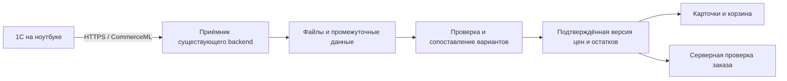

# Обмен с 1С — этап 9А

14 октября 2026; дополнено 15 октября 2026, Europe/Moscow. Задача [TASK-20261014-003](context/tasks/TASK-20261014-003.md). **IN_PROGRESS: подготовка выполнена; правила приняты; структура исторических таблиц проверена, фактический формат текущего обмена ещё не найден. Подготовлен план адаптации backend по новому поручению, реализация ожидает обсуждения плана. 9А не закрыт, 9Б не начат.** Общий итог остаётся 14/30.

## Поручение и порядок

USER_SPECIFIED 14.10: «вернемся к 9А и дальше по списку». Это возобновляет 9А сейчас, несмотря на прежний перенос 1С в конец плана. Далее 9Б→9В→9Г по порядку после проверки предыдущего этапа; новые этапы получают отдельные TASK. Исходные [подзадания](STEP-09-SUBTASKS-ASTRA.md) и [требования](REQUIREMENTS-FINAL-REVIEW.md) сохранены. Данные сайта и реальную 1С на 9А не менять; публикация, запись заказов в 1С и сообщения не входят в задачу. Работа только в основном проекте.

## VERIFIED — фактическое состояние

| Что установлено | Источник и проверка 14.10 |
|---|---|
| Каталог загружается из data/products.json; изображения накладываются отдельно | [catalog.ts](../lib/catalog.ts), [тип варианта](../lib/catalog-types.ts) |
| 4526 карточек, 6089 уникальных ID вариантов, 257 вариантов без SKU | Read-only пересчёт JSON основным агентом и независимым Astra-агентом; результаты совпали |
| 190 SKU используются более чем одним вариантом, всего 760 таких вариантов | Это повтор SKU, а не duplicate variant ID. Нельзя автоматически связать вариант 1С только по SKU |
| 5029 положительных исторических цен, 1060 null; все 6089 availability=unknown | Текущие сохранённые значения, не проверка живой 1С; data/summary.json имеет stock_is_live=false |
| Демонстрационный лимит 1 включён отдельно | [demo-inventory.ts](../lib/demo-inventory.ts); не переносить единицы в исходный каталог |
| Проверка заказа пока использует имеющийся каталог и тестовый лимит | [order-runtime.ts](../lib/order-runtime.ts), [friend-orders.ts](../lib/friend-orders.ts); это не источник актуальных остатков 1С |
| Отливанты имеют синтетические ID сайта; разные объёмы могут ссылаться на технический MIG_ID 1 мл | [import-catalog.py](../scripts/import-catalog.py), ветка perf/decant. Правило вычисления текущей цены/доступности из этой базы не согласовано |

Ни один исходный ID, вариант, цена, количество, изображение или браузерная корзина не менялись. Не запускался импорт. Сопоставление 9Б не подменяется приведёнными агрегатами.

## VERIFIED — структура имеющегося материала

Файл materials/Grace_1C_КАТЕГОРИИ_БРЕНДЫ_FINAL_v2(1).xlsx проверен чтением ZIP/XML, без запуска импорта. SHA-256: c118ca32af26f1609a351d387a90c135d2d57117e6444c38c43920e91bc98f3d. В книге 11 листов, в MASTER_РАСПРЕДЕЛЕНО 5317 строк данных. Основные колонки: MIG_ID, Категория 1С/Bitrix, Наименование, Наименование полное, Бренд, Ед.изм., Штрихкод(1-й), Все штрихкоды, Остаток, Розничная цена. Остальные колонки аудита/себестоимости для обмена сайта не требуются; значения себестоимости не выгружались в этот отчёт.

В заголовках основной таблицы нет отдельных полей GUID товара/характеристики, ID склада, резерва, ID вида цены, времени формирования, версии/номера обмена или признака полный/частичный. Наличие MIG_ID само по себе не доказывает, что он является стабильной ссылкой текущей базы 1С. Колонка «Розничная цена» не подтверждает выбранный владельцем актуальный вид цены.

Эта книга — исторический материал каталога. Она не является подтверждением текущего обмена или текущего наличия. Второй исходник Grace_1C_FINAL_IMPORT_5051.xlsx указан в импортере/summary, но отсутствует в materials; готовый результат импорта уже сохранён. Повторная замена/импорт по догадке не допускаются. Локальный отчёт структуры: artifacts/step-9a/material-structure.json (не включается в Git).

## VERIFIED — из прежней работы взято только нужное для обмена

По поручению «я уже работал с этими таблица чтобы сделать чистые 1с посмотри в переписках» проверены доступные сообщения чатов «Планирование приоритетов Grace Cosmetics», «Создание сайта Grace Cosmetics» и локальные материалы. В первом есть упоминания FINAL_IMPORT_5051 и TEST_IMPORT_100, но самих этих файлов в проверенных локальных папках нет. Локальный экспорт второго чата относится к созданию сайта. Полная переписка подготовки чистой 1С через доступную историю не получена; это ограничение поиска, а не доказательство отсутствия файлов в старых вложениях.

Найден Grace_1C_MASTER_миграция.xlsx в Downloads. Агент и основной исполнитель независимо прочитали ZIP/XML без изменения книги. SHA-256: 453f547e2e3ca3acfebf8b3400b25e236d532fde32c53859d1f07c089a131539. Для текущей задачи извлечено только:

| Нужное для 9А | Подтверждение в книге | Ограничение |
|---|---|---|
| MIG_ID, единица, штрихкод, остаток, розничная цена | Заголовки MASTER; 5317 строк данных | Нет отдельной внутренней ссылки товара/характеристики, резервов, времени среза и признака полного/частичного обмена |
| Вид цены «Розничная», связь по наименованию/MIG_ID | Схема_для_1С!B4 | Это схема подготовленной таблицы, не фактический ID вида цены рабочей базы |
| Склад и количество | Схема_для_1С!B5:C5 | Количество на дату перехода, не текущий свободный остаток |
| Неоднозначность одинаковых названий | Контроль!D7: 29 одинаковых названий нельзя разделить по этим отчётам, поскольку в них имя вместо внутренней ссылки 1С | Сопоставление только по названию небезопасно; MIG_ID не объявляется GUID рабочей базы |

USER_SPECIFIED: «Пока работает прежняя база»; «возьми из этих переписок тольок то что тебе первоначально нужно было». Перенос в чистую 1С не входит в продолжение: история используется только для идентификаторов, цен, остатков и ограничений сопоставления. Импорт, изменение баз и восстановление всего проекта миграции не выполнялись.

## USER_SPECIFIED — принятые правила 14 октября

Дословные ответы: «1с розница у меня на ноутбуке»; «розничные цены, склад один только, резервы вычитать, обновлять 2 раза в день»; «2.3, есть настроенный обмен с сайтом на битриксе через их встроенный плагин обмена. но сайт не функционирует он на паузе»; «Да, 12 часов / устаревание через 24 часа».

- Рабочая база — прежняя **1С:Розница 2.3 на ноутбуке**. Владелец сообщил о настроенном обмене с приостановленным сайтом Битрикс. Существующее подключение и режим файлов на диске проверены через UI; выполнение выгрузки и версия модуля ещё не проверены.
- Цена — розничная; склад один; доступность должна учитывать вычет резервов. Если источник уже отдаёт свободное количество, повторно резерв не вычитать.
- Обновление **каждые 12 часов**; после **24 часов** без успешного обновления наличие считается неподтверждённым. Владелец принял предложение о включённом ноутбуке с интернетом в моменты обновления. Расписание ещё не настроено.
- Не запрашивать эти решения повторно. Технические ID вида цены/склада, единицы и фактические поля проверить по текущему источнику.

## UNKNOWN — что осталось проверить в фактическом обмене

| Деталь | Требуемое свидетельство |
|---|---|
| Формат и идентификаторы | Фактические данные выбранного отправителя: ключи товара/характеристики, связь с MIG_ID/штрихкодом, версия формата и релиз конфигурации; существующие файлы не являются обязательным способом получения образца (поправка15.10) |
| Цена и единица | ID вида розничной цены, валюта, единица продажи, смысл налога; фактический учёт отливантов и связь объёмов |
| Свободное количество | ID единственного склада; отдельный резерв либо подтверждение, что он уже вычтен |
| Целостность обновления | Область полного/частичного обмена, время среза, порядок изменений, ноль/null/удаление/отсутствующая строка |
| Серверный приём | Доступный защищённый адрес и хранилище нового сайта; пока не настроены |

Исторические таблицы не содержат всех этих сведений. Доступы понадобятся после определения фактического транспорта и сохраняются только в защищённой серверной конфигурации; в документах и клиенте секретов нет.

## PROPOSED — минимальная проверка фактического формата

Нужен небольшой обезличенный пример из выбранного текущего обмена либо путь к уже имеющемуся файлу: обычный товар, два варианта одного товара, отливант при наличии, строка с нулевым остатком и строка без цены, если такие состояния есть в источнике. Реальную 1С ради получения этих состояний не менять. Клиенты, заказы, персональные данные, себестоимость и секреты в примере не нужны. Идентификаторы должны сохранять связи и различимость; имена/значения можно обезличить с описанием замен.

Проверить фактические поля, не навязывая источник под выдуманную схему: ключ товара+характеристики/готового SKU; единицу; вид цены и валюту; количество и смысл резерва; склад; время/версию и область обновления; null/ноль/отсутствующую строку. Формат транспорта и точные имена полей до примера остаются UNKNOWN. Полную выгрузку из частичной по количеству строк не угадывать.

## Проверка открытой 1С — 14 октября, в работе

USER_SPECIFIED: «лучше возьми мою открытую 1с на компьютере и проверь какие файлы ты можешь от него забрать. чтобы четко понимать функционал». Разрешён осмотр открытой программы и её возможностей выгрузки для 9А; изменение учётных данных, существующих настроек и запуск обмена со старым сайтом не требуются.

VERIFIED непосредственно через интерфейс: открыта «Розница (базовая), редакция 2.3», на начальной странице выбран склад «Торговый зал», виден раздел «1С-Битрикс: Управление сайтом» и команда «Выгрузка товаров в ТСД». Процесс использует платформу 8.3.18.1363; номер платформы не является номером релиза конфигурации. Название выбранного склада ещё не доказывает его ID/отбор в обмене.

В известных папках Documents/1c/RetailBase5 и Documents/InfoBase1 и их подкаталогах XML-файлов не найдено; проверены только имена, без открытия баз/логов. Другие папки этим выводом не охвачены.

После ответа владельца «Развернул 1С» захват изображения вновь завершился тайм-аутом. Клавиатурный поиск попал в фильтр магазина; исходное значение «Магазин» восстановлено и прочитано обратно. Дальше только владелец открывал нужные окна, основной агент читал дерево доступности. Учётные записи/пароли скрывались из вывода. Настройки не записывались и обмен не запускался. Окно со звёздочкой закрыто владельцем по инструкции без сохранения; отсутствие окна подключения повторно проверено в UI.

### VERIFIED — возможности и поля существующего подключения

Осмотрено подключение «Grace» к прежнему Битрикс и каталог «Товары Из 1С». Наличие функций подтверждено в открытом приложении, их выполнение пока не проверено.

| Что можно получить/настроить | Непосредственно увиденное | Что остаётся проверить |
|---|---|---|
| Локальные файлы обмена | Режим «Выгружать в каталог на диске» наряду с отправкой на сайт | Фактическое создание файлов, путь, имена, версия XML и состав пакета |
| Полную загрузку или изменения | Переключатели полной выгрузки и только изменённых объектов | Поведение удалений, нулей и отсутствующих строк в реальном пакете |
| Карточки номенклатуры | XML-соответствия для артикула, наименования, описания, страны, штрихкода; поле веса без сопоставленного реквизита; пакет 500 | Реальные ключи товара и заполненность реквизитов |
| Варианты/характеристики | Вкладка «Предложения», настройки характеристик, свойств и штрихкодов | Владелец подтвердил: «Выгружать предложения» НЕ установлено; вложенные настройки недоступны. Наличие вариантов в самой базе и требуемое представление пока не проверены |
| Розничные цены | Вкладка «Цены»: единственная строка «Розничная», пакет 1000 | ID вида цены, валюта, единица, конкретные значения и точность варианта |
| Остатки | Вкладка «Остатки»: строка «Магазин», пакет 1000; есть опция учёта резерва | ID склада/магазина и фактический свободный остаток |
| Идентификаторы и диагностика | Команды «Идентификаторы объектов», «Журнал обменов», «Журнал ошибок», «Версия модуля» | Содержимое этих форм; наличие ранее сохранённых XML/архива |

USER_SPECIFIED 14.10, проверка галочек владельцем: «Выгружать остатки с учетом резерва» — «Нет, не установлена»; «Выгружать предложения» — «Нет, не установлена». Владелец сообщил, что при осмотре только открывал окна/вкладки. Состояние галочек отмечено как подтверждённое владельцем, поскольку дерево доступности не возвращает checked-state.

Это расхождение с целевым правилом учёта резервов: текущий свободный остаток не доказан. Точную формулу и XML-поля нельзя выводить только из названия флага. [Официальное описание настроек Розницы 2.3](https://dev.1c-bitrix.ru/learning/course/index.php?COURSE_ID=131&LESSON_ID=20596&LESSON_PATH=10211.20586.20596) подтверждает назначение функций, но не заменяет чтение реального файла. Отключённые предложения также не доказывают отсутствие вариантов: они могут быть отдельной номенклатурой, что нужно проверить на примере.

На этой точке файл ещё не получен, интерфейс не считается испытанием выгрузки. Следующая поправка владельца: журнал пуст; сначала исследовать источники и определить план адаптации backend. Прежний следующий шаг поиска журнала заменён планированием ниже. Старое подключение не переключать и обмен на старый сайт не запускать.

## Серверный путь и неизменяемые ограничения

USER_SPECIFIED: получать данные сервером, с проверкой подлинности и без ключей в клиенте; не менять реальную базу 1С. USER_SPECIFIED: в рабочей Рознице 2.3 уже настроен обмен с Битрикс. PROPOSED для нового сайта: проверить штатную исходящую выгрузку CommerceML и принимать её отдельным серверным маршрутом. Официальное [описание возможностей Розницы](https://v8.1c.ru/retail/onlayn-prodazhi/) подтверждает интеграцию с поддерживающими CommerceML сайтами; [протокол1С](https://v8.1c.ru/tekhnologii/obmen-dannymi-i-integratsiya/standarty-i-formaty/protokol-obmena-s-saytom/) предусматривает передачу каталогов/цен/остатков по инициативе1С. Это кандидат для проверки, не выбранная/включённая интеграция этой базы. Обмен заказами исключён из нашего объёма.

Официальная [документация модуля для Розницы 2.3](https://dev.1c-bitrix.ru/learning/course/index.php?CHAPTER_ID=020586&COURSE_ID=131&LESSON_PATH=10211.20586) и [настройки подключения](https://dev.1c-bitrix.ru/learning/course/index.php?COURSE_ID=131&LESSON_ID=20594&LESSON_PATH=10211.20586.20594) проверены 14.10: модуль предусматривает выгрузку в каталог на диске. Наличие режима файлов на диске теперь подтверждено в приложении владельца; номер версии модуля и фактический пакет ещё не проверены. Существующее подключение не переключать и обмен не запускать автоматически. Конкретные адрес, права, расписание и хранилище нового сайта ещё не настроены.

Для 9Б сохранять отдельное проверяемое соответствие исходного ключа и variant.id сайта; неоднозначные/неизвестные варианты исключать. Для 9В принимать данные отдельно от витрины, различать полную/частичную загрузку, повторы и порядок. Для 9Г применять только проверенные сведения с откатом; неизвестная строка не означает ноль. Сохранять различие положительного, нулевого, неизвестного и устаревшего остатка; первичная загрузка/восстановление не являются поступлением. Эти ограничения взяты из исходных заданий, их реализация не заявляется результатом 9А.

## PROPOSED — план адаптации backend, 14 октября

Поправка15.10: первоначальная гипотеза использовать уже установленный дополнительный модуль пересмотрена в разделе «Выбор штатного обмена». Первым кандидатом является штатный Обмен с сайтом Розницы. Ссылки на дополнительный модуль ниже остаются историей исследования и не устанавливают его обязательность.

USER_SPECIFIED: «в журнале записей нет пока что. найди всю информацию в интернете и на форумах о подключении обмена с 1с»; затем «главное это то что нужно подбитьт бэкэнд сайта код сайта под условия обмена с 1с что для этого нужно 1с то и будем делать. но сначала давай определимся что нужно делать и как». Дословный многострочный запрос сохранён в поправке TASK. Пустой журнал подтверждён сообщением владельца, а не новым чтением UI.

Текущий результат — исследование и план. Перечисленные ниже изменения ещё не реализованы и настройки 1С не менялись. Исходные критерии 9А, включая реальный образец, остаются обязательными; план не закрывает A3.

### Предлагаемое решение

Адаптировать существующий backend под исходящий HTTP/CommerceML выбранного отправителя1С. Актуальный первый кандидат15.10 — штатный Обмен с сайтом Розницы2.3; необходимость дополнительного модуля не доказана. Сохранить каталог содержимого, URL, ID, изображения и тексты Grace. По открытому протоколу отдельная CMS Битрикс не является обязательной: совместимый обработчик можно реализовать в нашем приложении. Это архитектурный вывод, а не уже доказанная совместимость модуля владельца. Протокол инициирует 1С; публичный входящий доступ к ноутбуку для этой схемы не нужен. [Спецификация 1С](https://v8.1c.ru/tekhnologii/obmen-dannymi-i-integratsiya/standarty-i-formaty/protokol-obmena-s-saytom/).

Первый объём — товары/предложения как справочники для сопоставления, розничные цены и доступное количество одного склада с учётом резервов. Передача заказов, покупателей, оплат и документов обратно в 1С — отдельная задача. Полученный остаток не является резервированием: продажи между двумя обменами могут менять наличие; сохраняется подтверждение менеджером.

### Что проверено по документации и первичным обсуждениям

| Источник | Установлено | Вывод для нашего плана |
|---|---|---|
| [Базовый протокол 1С](https://v8.1c.ru/tekhnologii/obmen-dannymi-i-integratsiya/standarty-i-formaty/protokol-obmena-s-saytom/) | checkauth → init → POST file → повторяемый import; cookie, zip/file_limit и текстовые success/progress/failure | Нужен совместимый HTTP-диалог, а не только загрузка XML через браузер |
| [Расширенный алгоритм Битрикс](https://dev.1c-bitrix.ru/api_help/sale/algorithms/data_2_site.php?print=Y) | Дополнительные CSRF/время сервера, sessid/version, deactivate при полной выгрузке | Зафиксировать диалект установленного модуля. Упоминание версии 3.1 в документации не устанавливает версию XML владельца |
| [Состав файлов](https://dev.1c-bitrix.ru/api_help/sale/xml/index.php), [цены](https://dev.1c-bitrix.ru/api_help/sale/xml/prices.php), [остатки](https://dev.1c-bitrix.ru/api_help/sale/xml/rests.php), [предложения](https://dev.1c-bitrix.ru/api_help/sale/xml/offers.php) | Возможны раздельные import/offers/prices/rests, пакеты и каталоги goods/properties, суффиксы имён; ключ предложения может быть товар#характеристика | Обрабатывать фактическую структуру; не ждать исключительно двух файлов с фиксированными именами. В новой пакетной схеме одного СодержитТолькоИзменения недостаточно для определения full/delta |
| [Настройки подключения Розницы 2.3](https://dev.1c-bitrix.ru/learning/course/index.php?COURSE_ID=131&LESSON_ID=20594&LESSON_PATH=10211.20586.20594), [товары](https://dev.1c-bitrix.ru/learning/course/index.php?COURSE_ID=131&LESSON_ID=20596&LESSON_PATH=10211.20586.20596) | Для описанного модуля 8.x есть диск/сайт, полный/изменения, ручной/расписание, цены/остатки/характеристики | Возможности частично совпали с осмотренной программой, но её версия и результат выгрузки ещё неизвестны |
| [Первичный форум, 17.05.2017](https://dev.1c-bitrix.ru/community/forums/forum6/topic97043/) | Пользователь модуля 6.5.0.1 показал запрос complete после rests и ошибку несовместимого сервера | Добавить проверку завершения обмена по фактическому модулю; нельзя отвечать фиктивным success на неизвестную команду |
| [Первичный форум, 12–13.07.2021, сообщения 3828–3829](https://dev.1c-bitrix.ru/community/forums/forum26/topic19114/message686524/index.php) | Пользователь Розницы 2.3 описал проблемы регистрации изменения остатка/резерва и несколько XML-пакетов; представитель Битрикс объяснил разделение на пакеты, конкретный остаток требовал расследования | Проверять обычную продажу/резерв/нулевой остаток по реальному источнику. Это наблюдение чужой установки, не доказательство ошибки в базе Grace |

Источники проверены 14.10.2026. Форумы использованы как первичные наблюдения для сценариев проверки; старые советы не заменяют спецификацию и не копируются в рабочую 1С. Обзор покрывает относящиеся к нашему плану вопросы, а не весь интернет.

### Что потребуется от 1С

1. Поправка15.10: установить полный релиз Розницы2.3 и параметры штатного Обмена с сайтом. Версия дополнительного модуля нужна только если после сравнения выбран именно он. Платформа8.3.18.1363 не заменяет релиз конфигурации.
2. После согласования плана подготовить отдельную тестовую настройку для нового сайта и контролируемого ручного обмена с тестовым приёмником (поправка15.10; сейчас не создавать). Зафиксировать его настройки; прежний профиль Grace не перенаправлять. Если установка не поддерживает отдельный профиль, сначала определить безопасную альтернативу, не переключать существующий автоматически.
3. Получить контролируемый образец данных выбранного отправителя, например из будущей тестовой HTTP-передачи; сохранённые ранее файлы не требуются. Проверяемые случаи: обычный товар, несколько характеристик/вариантов, отливант, существующие ноль/резерв/отсутствующая цена. Недостающие состояния моделировать в тестовых XML либо копии базы; не создавать продажи/резервы в рабочем учёте ради теста. Сохранить связи ключей, исключить клиентов/заказы/себестоимость/секреты из публикуемых примеров.
4. Выбрать «Розничная», единственный склад/магазин и необходимые товары. По файлам и отчёту 1С установить, приходит свободное количество или отдельные количество и резерв. Целевое правило — вычесть резерв ровно один раз. В ранее осмотренном профиле дополнительного модуля флаг резерва был выключен; состояние и наличие такого параметра у штатного узла пока не установлены. Изменение новой настройки делать только после проверки смысла выгрузки.
5. Проверить необходимость предложений/характеристик для существующих вариантов: выключенный флаг в ранее осмотренном профиле дополнительного модуля не доказывает отсутствие вариантов и не описывает настройки штатного узла. Выгрузку изображений на первом этапе не включать; сайт уже хранит свои материалы. Справочники используются для связи, а не для автоматической перезаписи контента.
6. Сначала полная ручная выгрузка и сверка, затем проверка частичной. Для первого регулярного режима предлагается полный согласованный срез каждые 12 часов без изображений, если измеренный размер/время это допускают; переход на изменения — после испытания регистрации изменений и завершения пакетов. Поддержка full/delta остаётся критерием 9В.
7. Для публичного обмена — адрес HTTPS и отдельная учётная запись нового приёмника. Учётные данные старого Битрикс и других интеграций не переиспользовать. Проверить TLS именно с текущей платформой 1С; проверку сертификата не отключать.

Расписание — отдельная проверка работоспособности, а не только значение «12 часов». Если база файловая, исполнение регламентных заданий связано с клиентом 1С; одного включённого ноутбука и интернета недостаточно без работающего исполнителя. Основание: [официальные изменения платформы 8.3.7](https://downloads.v8.1c.ru/content/AutoUpdatesFiles/Platform/8_3_7_1949/V8Update.htm). Для текущей установки ещё проверить режим базы, активный сеанс, сон/выключение и восстановление после пропуска. Автоматизацию Windows/COM и обновление конфигурации сейчас не назначать по предположению.

### Что изменить в существующем backend

| Область и текущие точки | Минимальный результат будущей реализации |
|---|---|
| Новый маршрут существующего приложения, например app/api/1c/exchange/route.ts | GET/POST протокола; alias /bitrix/admin/1c_exchange.php только при доказанном ограничении отправителя, заранее не добавлять. Точный URL после проверки модуля; расширение .php в адресе само по себе не требует PHP |
| [Конфигурация размещения](../.openai/hosting.json), [runtime](../vite.config.ts), [схема](../db/schema.ts) | Постоянное хранение сеансов, сопоставлений и версий цен/остатков; отдельное хранение файлов/частей. PROPOSED: D1 + R2 в имеющемся Cloudflare runtime. В конфигурации основного checkout d1/r2 сейчас null; наличие/права production bindings не проверены. D1 сайта друзей не использовать |
| Новый серверный модуль приёма и разбора | Проверка полномочий каждого шага, cookie/CSRF по диалекту, лимиты размера/числа файлов/времени, изоляция сеансов, безопасные имена. XML без внешних сущностей/DTD; ZIP включать только с ограничением распаковки и проверкой путей. Для первого теста предложить zip=no, если модуль соблюдает его |
| Новый реестр соответствий | Источник базы + ключ номенклатуры/характеристики → существующие product.id и variant.id. Разделить технический ключ и MIG_ID/SKU/название. Неоднозначное — в отчёт, без угадывания; новые товары не создавать автоматически в рамках цен/остатков |
| Новые версии проверенных данных | Файлы принять и проверить отдельно; сформировать полный кандидат состояния, включая применение delta к предыдущему состоянию; атомарно переключить активную версию после подтверждённого окончания и проверки. Предыдущую сохранять для отката |
| [catalog.ts](../lib/catalog.ts), [типы](../lib/catalog-types.ts), [API каталога](../app/api/catalog/route.ts) | Сохранить JSON как каталог содержимого; накладывать актуальные цену, количество, время и версию при чтении через общий серверный источник. Учесть module-level Maps/подборки и кеш: простая запись в JSON не обновит всех потребителей |
| Карточки, подборки, поиск, категории, бренды, избранное, история | Один и тот же источник цен/наличия для SSR и API. Проверить также главную, статьи/рекомендации и коллекции, которые вычисляются из каталога при загрузке модуля |
| [shop-state](../lib/shop-state.ts), [store-shell](../components/store-shell.tsx), [корзина](../components/personal-pages.tsx), [checkout](../components/guest-checkout.tsx) | Корзина хранит старые объекты с ценами: сверять по ID, показывать изменения, сохранять позиции и ранее выбранное количество до явного подтверждения. Не урезать localStorage молча |
| [order-runtime](../lib/order-runtime.ts), [order-service](../lib/order-service.ts) | Переиспользовать async lookupVariant, revision/source=inventory и существующий 409 cart_changed. Зафиксировать одну ревизию на весь расчёт заявки; неизвестная/устаревшая доступность не выдаётся за подтверждённую |
| [demo-inventory](../lib/demo-inventory.ts) и его потребители | Переключить с тестовой единицы согласованно только после проверки нового источника. Не включать автоматически приём реальных заявок |

D1/R2 — рекомендуемое размещение по текущему коду, не уже выделенные ресурсы. До реализации 9В подтвердить, что у основного проекта доступны постоянная база, объектное хранилище, защищённые server-side secrets и публичный маршрут без интерактивной авторизации. Долговечность данных после перезапуска/публикации проверяется отдельно. При недоступности bindings сначала согласовать размещение приёмника; не создавать иной сайт автоматически. В памяти Worker/файлах сборки обмен не хранить. [R2 uploads](https://developers.cloudflare.com/workers/tutorials/upload-assets-with-r2/), [ограничения Workers](https://developers.cloudflare.com/workers/platform/limits/), [транзакционные batch D1](https://developers.cloudflare.com/d1/worker-api/d1-database/). Конкретные лимиты и стоимость выбирать по измеренному объёму и доступному тарифу; покупок в этом плане нет.

### Правила данных и сбоев

- Раздельно хранить время формирования источником, время приёма/активации, версию сопоставления и область покрытия. Не обновлять свежесть всего каталога только из-за успешного checkauth или повторного файла. «Изменений нет» подтверждает актуальность лишь при доказанной семантике завершённого обмена для всей нужной области.
- Через 24 часа без подтверждения наличие — неподтверждённое, не ноль. Предлагается сохранять последнюю проверенную цену с признаком давности, а при оформлении требовать подтверждённые данные. Историческая цена JSON не должна незаметно становиться текущей ценой 1С.
- Ноль, отсутствие поля, явное удаление и отсутствие строки различать. В delta отсутствующая строка не меняет прежнее значение. В full не обнулять/удалять по отсутствию до проверки покрытия и правил источника. Непокрытые варианты не считать свежими. deactivate не удаляет исходные карточки сайта.
- Не выводить full/delta по одному XML-атрибуту, имени файла или числу строк. Зафиксировать ожидаемые пакеты, область отбора и завершающие команды конкретного модуля. Если надёжной границы нет, автоматическую активацию не разрешать до решения этого вопроса.
- Повтор import/финализации завершённого пакета не создаёт повторного применения. У сырых частей file может не быть номера/смещения: нельзя удалять «дубликаты» только по одинаковым байтам. При неоднозначном обрыве сборки — отвергнуть кандидат и повторить выгрузку в новой сессии. Новая авторизация модуля сама по себе не означает новый полный обмен.
- Одновременные обмены одного источника сериализовать; запоздалый пакет не перезаписывает новую версию. Время ноутбука — недостаточный единственный критерий порядка. Оборванная/ошибочная загрузка оставляет прежнюю активную версию и её исходный возраст.
- После отката не сбрасывать маркеры уже обработанных обменов источника. Нельзя автоматически накладывать следующую delta на старый снимок: 1С могла уже считать пропущенные при откате изменения переданными. Пока непрерывность цепочки не доказана, delta не активировать; для первого режима восстановления требовать новую полную выгрузку. Этот сценарий включить в испытания отката.
- Суммы нормализовать в копейки, проверить валюту/вид цены/единицу/коэффициенты. Нулевую либо отсутствующую цену не превращать в бесплатный товар. Дробное количество хранить с единицей источника; продаваемые штуки рассчитывать только по подтверждённому правилу.
- Отливанты: проверить, это отдельные позиции/характеристики либо общий запас миллилитров. При общем запасе учитывать суммарный расход всех выбранных объёмов в одной корзине; нельзя каждому объёму выдать независимый полный запас. Правило цены за объём/флакон не придумывать. Без него эти варианты не получают автоматического расчёта.
- В диагностике — время последнего успешного обмена, размер/число пакетов, количество принятых/неизвестных/отклонённых строк и понятная причина ошибки; без паролей и клиентов. Первичный импорт, восстановление и откат не создают событий «товар поступил» для рассылок.

### Порядок и критерии будущих работ

| Этап | Результат | Проверяемая граница завершения |
|---|---|---|
| 9А — контракт | Идентифицированный отправитель/релиз + фактический формат и семантика, размещение и этот план; способ получения образца определить отдельно | Ключи/варианты, цена/единица, склад/резерв, полная/частичная область и конец обмена доказаны; неизвестное не заменено предположением |
| 9Б — сопоставление | Проверяемый реестр внешних ключей и существующих вариантов, пробное преобразование | Обычный товар, несколько характеристик, совпадающие SKU, отливанты; все принятые связи однозначны, остальные изолированы; ID/медиа/каталог неизменны |
| 9В — приём | Совместимый endpoint, постоянное промежуточное хранение, валидатор и диагностика | Реальная тестовая сессия; неверная авторизация, XML/пути/размер, части/повтор, full/delta, нули/удаления, обрыв, restart, параллельный/устаревший пакет; витрина не меняется от ошибочного пакета |
| 9Г — чтение данных | Общая активная версия для всех экранов и серверного оформления | Все затронутые списки/карточки/корзина показывают согласованные данные; обновление между просмотром и заказом даёт пересчёт/подтверждение; 24ч/откат/исходный возраст проверены; демо-лимит заменён согласованно |
| Подключение и зависимая приёмка | Отдельный профиль нового адреса, ручной тест, затем 12ч | Реальные товары/цены/остатки сверены с 1С; два ожидаемых обмена по расписанию зафиксированы; сон/сеть/закрытие клиента не маскируются успехом. Развёртывание и реальные заказы требуют соответствующего отдельного поручения |

Каждый этап получает свою задачу и независимую проверку агента с перепроверкой основным исполнителем. Сейчас 9Б–9Г не начаты. Актуальный шаг15.10 — проверить штатную настройку обмена и определить контракт её получателя. Существующие выгрузки искать не требуется; способ получения фактических данных на контролируемом тесте определить отдельно, не снимая критерии9А и не начиная9Б автоматически.

## VERIFIED / PROPOSED — повторная проверка собственного backend, 15 октября

USER_SPECIFIED: интеграция предназначена для собственного backend Grace, без CMS Битрикс и без шаблонного виджета. Модуль отправки внутри 1С и сервер сайта — разные стороны обмена. Прежний модуль можно рассматривать как источник CommerceML, если его фактический результат подходит; установка CMS Битрикс на сайте для выбранной архитектуры не требуется. Это уточняет область применения источников раздела от 14 октября: документация Битрикс описывает возможный диалект отправителя, а не обязательный стек получателя.

### Как это реализовывали вне Битрикс CMS

Источники прочитаны 15.10.2026. VERIFIED здесь означает проверенное содержание источника; чужие внедрения не запускались и не проходили наш эксплуатационный аудит.

| Первичный источник | Что сделал исполнитель | Что переносимо в Grace |
|---|---|---|
| [Webest, Laravel, 10.09.2025](https://habr.com/ru/articles/945736/) | Собственный API получает XML/ZIP от 1С, сохраняет пакет, выделяет объекты для обработки и ведёт статусы/ошибки файлов и объектов | Отделить приём от применения данных, сохранять диагностируемый результат. Статья описывает более широкий обмен заказами/контрагентами; точное соответствие её XML нашему CommerceML не установлено |
| [mavsan/laravel-1c-protocol](https://gitflic.ru/project/mavsan/laravel-1c-protocol) | Библиотека обслуживает HTTP-диалог, собственный Import записывает данные в модели приложения; предусмотрен отдельный режим для модуля Битрикс внутри 1С | Совместимый протокол не привязывает сервер к CMS. Автор отдельно предупреждает: прохождение протокольных тестов не доказывает правильность данных в БД |
| [carono/yii2-1c-exchange](https://github.com/carono/yii2-1c-exchange) | Приложение подключает собственные модели товаров, предложений и цен через интерфейсы; хранит внешний accounting_id | Разделить внешний ключ и ID сайта, адаптировать данные к нашим моделям, сохранив каталог Grace |
| [Александр Прозоров, Node.js, 12.08.2013](https://habr.com/ru/articles/189812/) | Для каталога около 26 тысяч позиций разработчик 1С заменил XML-выгрузку на JSON; отдельный Node-сервис получал файлы через FTP и запускался по HTTP | JSON возможен, но в этом кейсе потребовал разработки в 1С. Старые цифры скорости относятся к конкретной реализации, не доказывают превосходство JSON для Grace. FTP и старую схему подтверждения обработки не копировать |

Это примеры подходов, а не список рекомендуемых зависимостей: PHP/Python-пакеты не устанавливаем в существующий TypeScript/Cloudflare backend. Из публикаций нельзя вывести поддержку JSON или внешней обработки именно нашей базовой Розницей без проверки её ограничений.

### Какие конкретные ошибки обнаружены

| Свидетельство | Ошибка и предел доказательства | Требование к нашему приёмнику |
|---|---|---|
| [Yii, issue #12](https://github.com/carono/yii2-1c-exchange/issues/12), сообщения 2020–2022 | Участники описали удаление общего classifier.xml после первого import_01.xml, из-за чего import_02.xml уже не обрабатывался; отмечали повторные init. Issue открыт, исправление upstream не подтверждено | Сохранять общие файлы до доказанного конца логического обмена; повторный init сам по себе не разрешает очистку |
| [bigperson/exchange1c, issue #7](https://github.com/bigperson/exchange1c/issues/7), 2022 | Автор сообщил о сбое авторизации при нестандартном SESSION_COOKIE; пользователь подтвердил обход заменой имени. Issue открыт | Проверять полный цикл checkauth → последующие запросы именно клиента 1С. Имя PHPSESSID — частный обход чужой ошибки, не универсальное требование |
| [Yii, issue #9](https://github.com/carono/yii2-1c-exchange/issues/9), 2020 | Автор зарегистрировал высокое потребление памяти при больших XML. В issue не приведены размеры и подтверждение исправления | Измерить реальные файлы и время/память на нашем runtime; ограничить размер и объём одного шага, не загружать весь каталог в память без измерения |
| [django-cml, views.py](https://github.com/ArtemiusUA/django-cml/blob/master/cml/views.py), upload_file | По чтению кода файл открывается с wb при каждом POST: последовательные части одного файла будут перезаписывать предшествующие. Это статический вывод, не воспроизведённый инцидент | Проверить сборку частей в правильном порядке; отдельно проверить неоднозначный сетевой повтор и новую сессию после обрыва |
| [django-cml, utils.py](https://github.com/ArtemiusUA/django-cml/blob/master/cml/utils.py) + views.py | По чтению цепочки вызовов ошибка XML может быть записана в лог и подавлена менеджером, после чего обработчик вернёт success. Это статический вывод, не воспроизведённый инцидент | Повреждённый XML не даёт успешный import, новую активную версию или обновление свежести; ошибка доступна в диагностике |

Cookie-совместимость также описана автором mavsan: схема его сессии конфликтует с обычным шифрованием cookie Laravel. Вывод для Grace — отдельная проверяемая сессия протокола, а не отключение защиты всего сайта. Старый код django-cml использован для разбора ошибок; его запуск или пригодность для современного production не проверены.

### Что уточняется в плане Grace

1. **Собственный маршрут и модель данных.** Базовый адрес — маршрут существующего backend, например /api/1c/exchange. Alias со словом bitrix нужен только при доказанном ограничении отправителя; заранее его не добавлять. Виджеты, смена CMS и перенос каталога не требуются.
2. **Поправка15.10 — контракт выбранного отправителя.** Сначала идентифицировать штатный механизм и релиз; для будущего контролируемого теста определить сбор фактических передаваемых данных и очищенного от секретов списка команд/ответов: порядок, имена файлов, кодировка, cookie-механизм, повторные init, граница full/delta и завершение. Один import.xml этого не доказывает. Контролируемый диалог с будущим тестовым приёмником проверяется на 9В; на 9А фиксируются доступный образец и ожидаемый контракт. В репозиторий не включать сырые заголовки авторизации, cookie, покупательские данные или рабочие выгрузки.
3. **Долговечный приём и явные статусы.** Сначала сохранить файл/часть, затем проверить и подготовить кандидат. Различать «часть принята», «файл обработан», «обмен завершён» и «версия активирована». success означает результат соответствующей команды: сохранение file ещё не означает применение каталога; import не объявляется успешным только из-за постановки в очередь. Конкретный механизм ограниченных шагов/progress выбрать по диалекту и runtime. RabbitMQ, Kafka и отдельный сервер заранее не назначать.
4. **Сохранить единый итог обмена.** Классификатор, предложения, цены и остатки могут зависеть друг от друга. Порядок/повтор команд не должен приводить к ранней очистке, частичной публикации либо обновлению свежести непроверенных данных. Неизвестную команду не скрывать фиктивным success.
5. **Добавить направленные проверки 9В.** Несколько import_*.xml с общим классификатором; init между пакетами; cookie после checkauth; файл из нескольких POST; повреждённый XML; неподдерживаемая кодировка/структура с понятной ошибкой; рестарт между приёмом и обработкой; превышение размера/времени. Ошибочная загрузка сохраняет прежнюю активную версию и исходный возраст. Синтетические тесты не заменяют реальную сессию 1С.

Рекомендация остаётся PROPOSED: **адаптер фактического CommerceML в нашем backend** — первый вариант со штатной отправкой Розницы, если проверка подтвердит нужный состав данных. Если образец покажет, что нужные характеристики/резервы/единицы получить нельзя, сначала оценить изменение отдельного профиля или поддерживаемый компонент на стороне 1С. Собственный JSON/HTTP-контракт — альтернативный вариант с отдельной стоимостью разработки и сопровождения 1С; его необходимость пока не доказана. Локальные XML полезны для диагностики и повторяемых тестов, но ручной перенос файлов не выполняет требование обмена каждые 12 часов.

UNKNOWN остаются именно свойства установки владельца: реальные ID/характеристики, смысл количества и резерва, общий запас отливантов, область полной выгрузки, регистрация изменений, завершение и работоспособность расписания. Чужие успешные внедрения эти пробелы не закрывают. Актуальный следующий шаг9А15.10 — штатные настройки и их контракт. Наличие ранее сохранённой выгрузки и номер дополнительного модуля не являются обязательным входом; проверка фактических данных всё ещё нужна перед завершением этапа.

## История осмотра модуля — 15 октября, дальнейшая навигация отменена

USER_SPECIFIED: «давай, проверь версию модуля в открытой 1с и найди файлы выгрузки»; затем «файлов обмена не будет» и «версия 2.3 розница». Поиск файлов прекращён до начала; новые выгрузки не запрашиваются в этом поручении. Это уточнение не устанавливает формат будущего HTTP-обмена и не отменяет проверку контракта перед реализацией.

VERIFIED через свежие list_apps/get_window_state: открыта «Розница (базовая), редакция 2.3»; путь запущенного клиента содержит платформу 8.3.18.1363. Полный релиз конфигурации и номер модуля обмена остаются UNKNOWN. На первом чтении уже была форма «Обмен с *»; звёздочка предшествовала действиям агента. Значения не устанавливались, сохранение и запуск обмена не нажимались.

Переход к разделу через click завершился ошибкой «coordinate input geometry is unavailable». Повторное чтение показало меню «Маркетинг», поэтому неизменность всей навигации не заявляется. Восстановление доступа столкнулось с «user input was detected in this window» и «window is minimized»; дальнейшие нажатия прекращены. Содержимое команды «Версия модуля» не получено.

OBSOLETE как следующий шаг: владельцу ранее предложено открыть наблюдавшуюся команду «1С-Битрикс: Управление сайтом» → «Версия модуля» либо написать показанный номер. До ответа номер не угадывать по редакции Розницы, версии платформы, названию формы или интернет-документации. Агент независимо сверил прежние наблюдения и ограничения; основной исполнитель проверил выводы. 9А остаётся IN_PROGRESS.

## Выбор штатного обмена — исправление плана 15 октября

USER_SPECIFIED: владелец указал на Сервис → Обмен с сайтом → Настройки обмена с сайтом и потребовал независимо проверить выбор дополнительного модуля и прежние действия. Полный дословный запрос сохранён в поправке A12 задачи. **Вердикт: первым проверять штатный обмен Розницы2.3; дополнительный модуль Битрикс не является обязательным условием.** Это выбор точки интеграции, а не подтверждение работоспособного обмена.

Основания, проверенные основным исполнителем:

- [Официальное руководство Розницы2.3, раздел6.3](https://its.1c.ru/db/retaildoc/content/77/hdoc) содержит подраздел «Обмен с произвольным интернет-магазином». Доступно оглавление; полный подраздел вернул401, поэтому его подробные настройки не объявляются прочитанными.
- [Официальные изменения Розницы2.3.1](https://its.1c.ru/db/content/updinfoarch/src/retail23/2.3.1/index.htm) прямо описывают собственную подсистему обмена и путь Администрирование → Обмен с сайтом → Настройки обмена с сайтом. Расположение группы Сервис может зависеть от интерфейса.
- [Документация дополнительного модуля](https://dev.1c-bitrix.ru/learning/course/index.php?COURSE_ID=131&TYPE=Y), глава о Рознице2.3, отдельно оговаривает установленный модуль8.x и отличающиеся возможности встроенного механизма. Это прямо подтверждает, что ранее использованная инструкция не универсальна для двух отправителей.
- [Открытый протокол1С](https://v8.1c.ru/tekhnologii/obmen-dannymi-i-integratsiya/standarty-i-formaty/protokol-obmena-s-saytom/) предусматривает исходящий HTTP-диалог и CommerceML; приёмником может быть совместимый код нашего сайта. Отсутствие готовых файлов на ноутбуке не означает отсутствия XML/частей файлов в последующей передаче. Это объяснение протокола, не разрешение возобновить поиск или запускать обмен.
- [Официальный changelog Розницы](https://dl03.1c.ru/content/Retail/2_3_5_28/change.htm) называет штатный ОбщийМодуль.ОбменССайтомРТ и ошибку00-00301050: в определённых настройках не передавались предложения с ценами/остатками; версия исправления указана РТ2.3.4. Поэтому нужен полный релиз установленной конфигурации; по одному обозначению2.3 нельзя ни объявить баг присутствующим, ни считать его исправленным.

Самопроверка действий: исходное упоминание владельцем старого плагина оправдывало рассмотрение этого кандидата, но не его выбор без сравнения. Агент преждевременно сделал номер дополнительного модуля обязательным шагом и продолжил связанную навигацию; следовало сначала проверить встроенный механизм. Появление иной формы «Обмен с *» было поводом проверить различие. Наличие доступной команды «Версия модуля» не устанавливает, какой код обслуживает эту форму. Также ошибочно было превращать поиск существующего XML в единственный путь к определению контракта. Архитектура собственного приёмника, сопоставления ID, проверок и атомарного применения остаётся обоснованной.

VERIFIED UI15.10: в форме «Обмен с *» прочитаны варианты обновления цен/остатков и выгрузки описаний, флажок характеристик и режимы всех данных/изменений; их включённость не установлена. Последнее чтение показало список «Настройки обмена с сайтами». Это совпадает с назначением штатного механизма, но само название формы не доказывает отсутствие расширений/изменений. Поля ранее изученного профиля дополнительного модуля — «Розничная», выключенные флаги резервов/предложений — не переносятся как проверенные настройки нового штатного узла.

Актуальная схема: штатный Обмен с сайтом → собственный защищённый HTTP-приёмник Grace → проверка/сопоставление → цены и остатки сайта. На первом шаге изучить текущую штатную настройку и полный релиз, не записывая её; затем подготовить контракт и отдельную контролируемую проверку. Если сохранённых выгрузок нет, образец допустимо получить как данные будущей тестовой передачи. Создание/изменение узла и запуск такого теста не выполнены и не подразумеваются разрешёнными этим запросом на анализ.

Для штатного узла ещё UNKNOWN: фактическая цена/единица, свободный остаток и резерв, характеристики/отливанты, конкретный HTTP-диалект и завершение, исполнение расписания. Дополнительный модуль имеет смысл возвращать в рассмотрение только при доказанном пробеле штатного обмена; его техническая совместимость с собственным backend возможна, но не делает его необходимым. Прежний запрос открыть его версию не действует как следующий шаг.

## Приёмка и продолжение

- A1 PASS: архитектура и агрегаты JSON независимо проверены двумя агентами; структуру исторической XLSX прочитал основной агент.
- A2 PASS: конфигурация, рабочая база, существующий обмен и бизнес-правила подтверждены владельцем; технические поля остаются в A3.
- A3 NOT RUN: текущий фактический формат 1С ещё не предоставлен/не проверен.
- A4: документ фиксирует принятые правила, проверенную историческую структуру и точный пробел A3; финальная приёмка после проверки фактического формата.
- A5 PASS для сохранённой подготовки: документация отправлена в origin/main; SHA bffb3ef94c9c3b38d039e286e4f800ef6c5a25dd подтверждён через git ls-remote. Context audit и diff check PASS; код/каталог не изменены, основной 5173 HTTP 200. Это не закрывает этап.
- A8 PARTIAL: открытый профиль, локальный режим, поля товаров, цены и остатки проверены; получение файла и его структура ещё не проверены.
- A6 PASS: доступная история и найденный материал проверены, взяты только сведения для обмена; результаты агента сверены основным исполнителем.
- A9: подготовлен план по официальной документации, первичным форумным сообщениям и текущему коду; независимые выводы двух агентов перепроверены основным исполнителем. Совместимость и живое расписание этим не доказаны.
- A10: повторно исследованы собственные Laravel/Yii/Node-приёмники и код Django; разделены свидетельства авторов, зарегистрированные ошибки и статические выводы. План уточнён для собственного backend; реальная совместимость не заявляется.
- A11: свежий осмотр подтвердил редакцию и платформу; номер дополнительного модуля UNKNOWN, ограничения чтения записаны. Требование продолжать к его окну отменено последующим поручением; поиск файлов прекращён.
- A12: выбран для первичной проверки штатный Обмен с сайтом; прежняя привязка к дополнительному модулю признана необоснованной. Возможности проверены по официальным источникам, фактический обмен не проверен.
- Следующий шаг15.10: в штатных Настройках обмена с сайтом прочитать адрес/режим получателя, состав выгрузки, цену, склад и расписание без сохранения и запуска; уточнить полный релиз Розницы. Затем определить контролируемую проверку фактического контракта. A3/A4/A8 открыты, 9Б не начат. Общий итог14/30.
